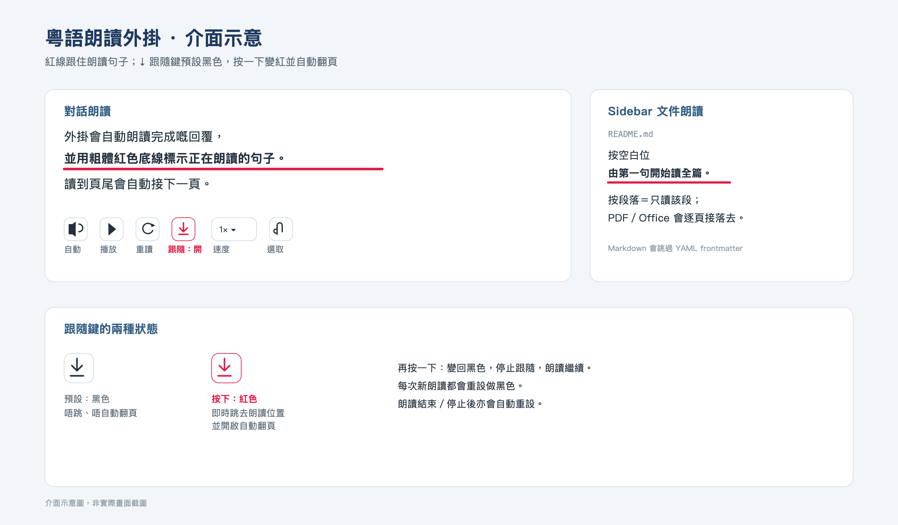

# 快速示範（Demo）

> 上圖係介面示意圖，唔係實際畫面截圖；實際按鈕位置喺輸入框左邊。

## 30 秒試一次（對話）

1. 等助手完成一個回覆。
2. 按輸入框左邊嘅 **▶**：應該由頭讀出最新回覆，句子有粗體紅色底線。
3. 按 **↓**：箭嘴變紅，畫面跳去正在朗讀嘅句子。
4. 等朗讀接近畫面底部：跟隨時會平滑捲到上面約 1/3，做到自動翻頁。
5. 再按 **↓**：變回黑色，停止跟隨；朗讀繼續。
6. 按 **↻**：由頭重讀目前文字，底線照常出現。

## Sidebar 文件

1. 右邊 Sidebar 打開一個 `.md` 或 `.txt`／code file。
2. 按輸入框左邊嘅食指按鈕，再 hover 文件：空白位會框住整份文件。
3. 按空白位：由第一句開始讀全篇。
4. 按段落：只讀該段。
5. 開紅色 **↓**：讀到接近底部會自動捲動／翻頁。

## PDF／Office

1. Sidebar 打開 PDF 或 docx／pptx（Office 會轉 PDF 預覽）。
2. 按某一頁文字：由該頁開始讀，讀到頁尾會自動接下一頁。
3. 按頁與頁之間嘅空白：由第一頁開始讀全份。
4. PDF 文字層係逐頁按需要建立，第一次可能等一兩秒。

## 重讀與選取

- **↻** 會記住你上次用手指選取嘅文件／段落，重讀時底線仍然喺原位。
- 每次新朗讀都會將 **↓** 重設做黑色。
- 停止、讀完或出錯會清除底線。

## Web／手機版

- Web profile 用 Browser TTS（Web Speech API），聲音由開網頁嘅裝置播出。
- 功能同 Desktop 一樣：紅線、↓ 跟隨、Sidebar 文件、PDF 接頁。
- 第一次按喇叭開啟自動朗讀時，會讀一句確認並解鎖 browser speech。

## 已知限制

- PDF／Office 上限 8,000 字；較長文件會停。
- 掃描 PDF、圖片、Excel、HTML 預覽冇可讀文字層。
- 任意外部網站刻意唔支援，保障私隱。
- Markdown 會跳過 YAML frontmatter。
- 跨 origin iframe 讀不到。

## 疑難排解

| 情況 | 做法 |
|---|---|
| 按鈕不見 | 重新整理；仍未見就重開 DSH |
| 冇聲 | 檢查音量／輸出；確認 Sinji、Samantha；Web 版先按一次喇叭 |
| PDF 有字讀唔到 | 多數係 PDF 文字層缺失；掃描件需要 OCR，暫未支援 |
| PDF 讀到頁尾停 | 到 8,000 字上限，或下一頁未有文字層 |
| Sidebar 空白冇反應 | 確認係 Markdown／純文字／PDF／Office 預覽 |

完整指南：[USER-GUIDE.pdf](USER-GUIDE.pdf) ／ [USER-GUIDE.md](USER-GUIDE.md)
